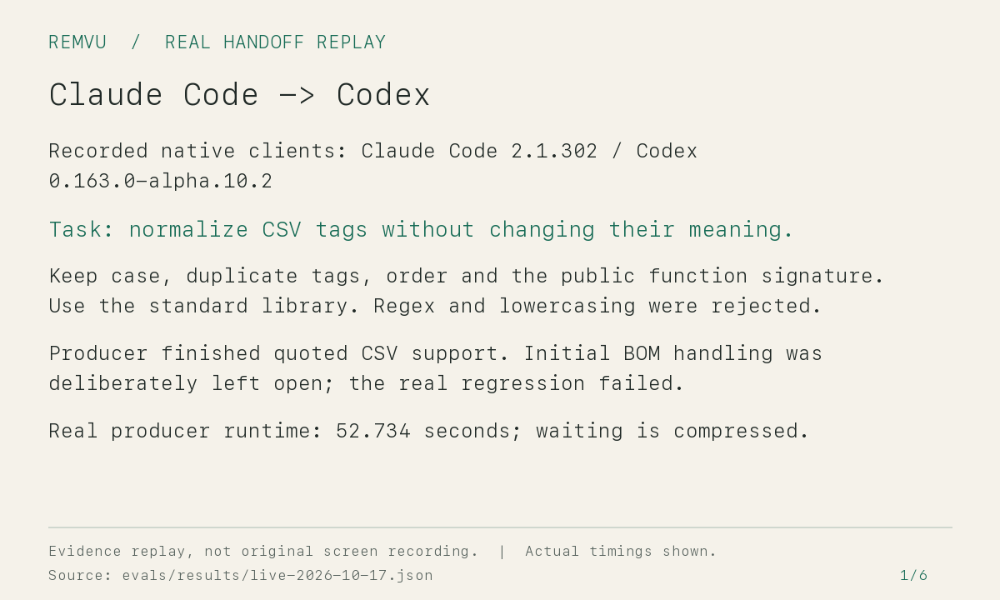

# Remvu

**在 Claude Code 额度用完前保存背景，再到 Codex 接着做。**

Remvu 是一个 Markdown skill。它把目标、约束、否决过的方案、验证结果和未完成事项写成一份交接文件，让下一个 AI 带着背景继续工作。默认用法无需 Python、hooks、Remvu 账号或后台服务。

[English](README.md) · [安装说明](docs/quickstart.zh-CN.md) · [实际支持范围](docs/compatibility.md)

## 开始使用

把这句话交给你的编程 agent：

> 从 https://github.com/caotaiyi/remvu 安装 Markdown 版 Remvu skill 到当前项目的 Claude Code 和 Codex skill 目录。先审阅，再在 macOS 使用 scripts/install-skill.sh，Windows 使用 scripts/install-skill.ps1。保留已有 skill，不运行可选的 Python 安装器，不启用 hooks。

安装器使用 Git 获取源码，也可以使用本地已审阅的源码。它只复制 skill，不改客户端设置。仍需遵守客户端正常的项目信任流程；如果未发现 skill，打开新会话。

| 动作 | Claude Code | Codex |
| --- | --- | --- |
| 离开前保存 | `/remvu save` | `$remvu save` |
| 新会话接着做 | `/remvu resume` | `$remvu resume` |

保存文件在本地 `.remvu/notes/REMVU.md`，不会自动提交或上传。接手方读取它、检查代码是否变化，再继续你的任务。如果换了电脑，需要一起带走代码和这份文件。接手方不必安装 Remvu，直接告诉 agent“读取这个交接文件并继续”也可以。

请在原 agent 仍能响应时保存。如果额度已用完且没有笔记，轻量版无法恢复此前未保存的聊天背景；接手方只能检查代码，并明确哪些背景还缺失。

## 30 秒看懂流程

1. Claude Code 中输入 `/remvu save`。
2. 在 Codex 打开同一个项目，输入 `$remvu resume`。
3. 确认下一步和未验证事项，继续工作。

这是额度切换场景的使用流程，不需要真的用完额度。下面是旧版两个小型真实 CLI 接手试验的证据回放，不是新版本录屏，也不代表任务实际耗时。

[试验来源及限制](docs/demo.md)。轻量版已另做十任务 CLI 对照，结果见下文；旧版通过不能证明新入口兼容。

## 留下什么

每条重要信息区分用户确认、工具观察、agent 推断和待核实。被否决的方案、失败检查、未完成事项和决定的替代关系都会保留。首读摘要通常控制在 2,000 字符以内，重要细节放在后续章节。

保存由你主动触发。Remvu 不拦截会话结束；可选记录器的 Stop 处理也已改为不阻塞。它不承诺完整转录所有操作，缺失证据会明确列出。

轻量文件采用 `remvu-note/1` 约定。它没有自动代码指纹、并发锁或严格校验保障；接手时需要检查代码变化并重跑相关检查。保存后 agent 会回读文件，但这不能证明内容绝对完整。[具体规则](skills/remvu/references/notes.md)。

## 高级能力仍然保留

需要严格的 `remvu/1` 格式、代码指纹、事件索引、并发更新保护或恢复时，可以启用原有 Python 引擎，macOS/Linux 需要 Python 3.9+，Windows 需要 Python 3.10+，并需要 Git。日常 save/resume 不依赖它。旧版记录、导出格式和 release 继续保留。[引擎工作流](skills/remvu/references/engine-workflow.md) · [维护说明](skills/remvu/references/maintenance.md) · [开放格式](spec/remvu-v1.md)。

公开分享需要单独提出请求，再筛选可公开的项目事实和证据。私有交接文件不会自动变为公开 `REMVU.md`。不导出隐藏思考链、密钥或无关聊天。

## 多模型平台与 API 中转站

换模型、换客户端，把项目背景一起带走。能取得项目文件与可观察结果的平台可以采用开放格式；单纯转发 API 请求无法补齐项目操作记录。目前没有内置的中转站专用适配器。

## 当前进度

当前仍为 **v0.3.0-beta.1 候选版**。Windows、桌面入口和 VS Code 原生验收尚未完成；复制成功或 CLI 通过不能证明这些入口兼容。[兼容矩阵](docs/compatibility.md) · [测试报告](docs/beta-validation.md)。

本轮十任务真实 CLI 对照中，普通 HANDOFF.md 与 Remvu 均首次通过 9/10，剩余任务各经一次纠正后完成。Remvu 文件更大，总计 34,614 字节，对照组为 10,039 字节。本轮没有证明完成效果、token 或费用方面的收益。[实测与限制](docs/product-validation.md) · [实验方案](evals/markdown-protocol.md)。

MIT 开源协议。[参与贡献](CONTRIBUTING.md)。
